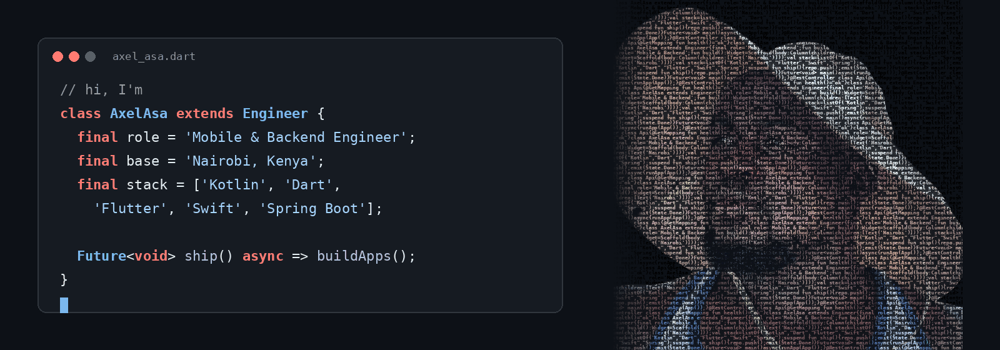
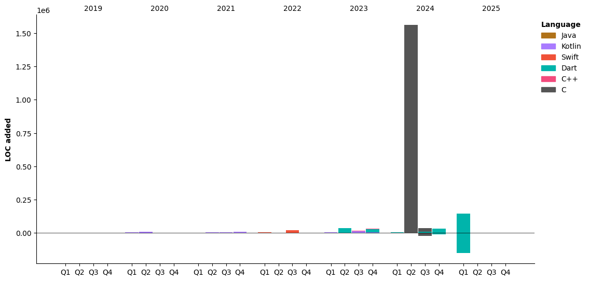

 <div align="center"> <a href="https://git.io/typing-svg">  </a> <br/>

  <div align="center"> <a href="https://git.io/typing-svg">  </a> <br/>

<a href="https://www.linkedin.com/in/axel-asa-855203141/"></a> <a href="https://twitter.com/AxelAsa2"></a> <a href="https://www.instagram.com/axelasa/"></a> <a href="mailto:asaaxel82@gmail.com"></a> 

</div>

<a href="https://www.linkedin.com/in/axel-asa-855203141/"></a> <a href="https://twitter.com/AxelAsa2"></a> <a href="https://www.instagram.com/axelasa/"></a> <a href="mailto:asaaxel82@gmail.com"></a> 

</div> -->


<br>
 
<center>
<table>
<tr>
<td></td>
<td></td>
</tr>
</table>
</center>
- 👀 I’m interested in Mobile Application Development
- I also do Hybrid Applications using Flutter
- 🌱 I’m currently well versed in Android, iOS, RestApi
- SDKs -> Android iOS
- Frameworks -> Flutter, Spring Boot
- 💞️ I’m looking to collaborate on any native Mobile App
- 📫 you can reach me by email at asaaxel82@gmail.com 
- And on my cell +254794227892.
 
 
  
 ## 🏆 GitHub Trophies
  
 [](https://github.com/ryo-ma/github-profile-trophy)
 
 <!--START_SECTION:waka-->


**🐱 My GitHub Data** 

> 📦 985.8 kB Used in GitHub's Storage 
 > 
> 🏆 90 Contributions in the Year 2025
 > 
> 🚫 Not Opted to Hire
 > 
> 📜 65 Public Repositories 
 > 
> 🔑 11 Private Repositories 
 > 
📊 **This Week I Spent My Time On** 

```text
🕑︎ Time Zone: Africa/Nairobi

💬 Programming Languages: 
No Activity Tracked This Week
```

**I Mostly Code in Kotlin** 

```text
Kotlin                   26 repos            ███████████░░░░░░░░░░░░░░   44.07 % 
Dart                     21 repos            █████████░░░░░░░░░░░░░░░░   35.59 % 
C++                      3 repos             █░░░░░░░░░░░░░░░░░░░░░░░░   05.08 % 
C                        2 repos             █░░░░░░░░░░░░░░░░░░░░░░░░   03.39 % 
TypeScript               1 repo              ░░░░░░░░░░░░░░░░░░░░░░░░░   01.69 % 
```


**Timeline**




 Last Updated on 01/09/2025 01:45:33 UTC
<!--END_SECTION:waka-->

<!---
axelasa/axelasa is a ✨ special ✨ repository because its `README.md` (this file) appears on your GitHub profile.
You can click the Preview link to take a look at your changes.
--->
